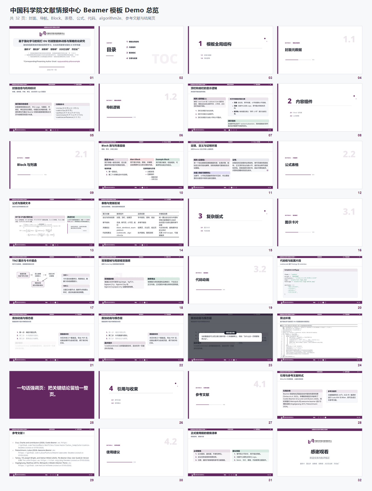

# 中国科学院文献情报中心 Beamer 模板

这是一个面向 **中国科学院文献情报中心（National Science Library, Chinese Academy of Sciences）** 的中文 Beamer 模板，适用于学术报告、会议汇报、组会以及硕博论文答辩。

模板基于 [Cookie Beamer](https://github.com/SeniorMars/dotfiles/tree/main/latex_template/cookie-beamer) 改造，加入文献中心标识、会议顶栏、章节与小节导航、正文页脚、中文封面和结尾页，并提供覆盖主要组件的中文 Demo。本项目为社区维护模板，并非中国科学院文献情报中心官方发布物。

## 效果预览

[查看完整 Demo PDF](demo.pdf)



## 主要特性

- **机构化封面**：支持会议名称、Logo、主副标题、作者、单位、日期和联系邮箱。
- **多级结构导航**：根据 `\section` 和 `\subsection` 自动生成目录、章节页、小节页、顶栏与页脚导航。
- **可配置进度信息**：支持页码、章节/小节编号轨道、进度条和小节进度点。
- **完整内容组件**：提供 Block、定理与证明、卡片、引用框、表格、代码框、TikZ 图示、背景图页面、覆盖层、模态层和强调页。
- **公式与算法支持**：数学公式采用 LaTeX 默认衬线风格；`algorithm2e` 提供中文输入/输出、三线式标题、行号、块线和 `end` 标记。
- **参考文献支持**：Demo 使用 BibLaTeX 与 Biber，展示正文引用和参考文献页样式。
- **演讲者模式**：支持隐藏笔记、显示笔记、第二屏笔记和仅输出笔记。
- **开箱即用**：主题文件、Logo、Demo、参考文献数据和 `latexmk` 配置均包含在仓库中。

## 文件结构

| 文件 | 说明 |
|---|---|
| `beamerthemecookie.sty` | Beamer 主题文件 |
| `demo.tex` | 中文 Demo 源文件，展示模板主要效果 |
| `demo.pdf` | 已编译的 32 页中文 Demo |
| `demo-overview.png` | Demo 全部页面拼接总览图 |
| `refs.bib` | Demo 使用的 BibLaTeX 参考文献数据 |
| `assets/文献中心logo.png` | 封面与结尾页使用的 Logo |
| `assets/文献中心logo_白色.png` | 正文页脚使用的白色 Logo |
| `.latexmkrc` | LuaLaTeX 与 Biber 编译配置 |
| `.gitignore` | LaTeX 中间文件与临时目录忽略规则 |

## 环境要求

推荐使用较完整的 TeX Live 或 MiKTeX，并使用 **LuaLaTeX** 编译。核心依赖包括：

- `beamer`、`ctex`、`fontspec`
- `tikz`、`tcolorbox`、`listings`
- `adjustbox`、`microtype`
- `algorithm2e`
- `biblatex` 与 `biber`（使用参考文献时）

主题会在可用时加载 `qrcode`、`tikzlings-penguins` 和 `tikzsymbols`；缺少这些可选包时仍可使用对应的降级样式。

## 编译 Demo

项目根目录已经提供 `.latexmkrc`，可直接运行：

```sh
latexmk demo.tex
```

该配置使用 LuaLaTeX，并自动调用 Biber。若需要手动编译，可执行：

```sh
lualatex demo.tex
biber demo
lualatex demo.tex
lualatex demo.tex
```

清理编译中间文件：

```sh
latexmk -c
```

## 快速开始

将 `beamerthemecookie.sty` 与 `assets/` 放在主文件同级目录，然后使用：

```tex
\documentclass[aspectratio=169]{beamer}

\usepackage[UTF8]{ctex}
\usepackage{amsmath,amssymb}

\definecolor{nslPurple}{HTML}{642860}
\usetheme[
  accent=nslPurple,
  progressbar=foot,
  sectionpage=progressbar,
  subsectionpage=progressbar,
  numbering=fraction,
  numberrail=subsection,
  numberrailcolor=muted,
  block=fill,
  covered=transparent,
  notes=hide,
  toc=aftertitle,
  closing=contact
]{cookie}

\title[短标题]{报告或论文标题}
\subtitle{副标题}
\author[短作者]{作者列表}
\institute[短单位]{单位列表}
\date{\today}

\cookieconference{完整会议名称或硕博论文答辩}
\cookieheaderconference{正文顶栏使用的较短会议名称}
\cookielogo{assets/文献中心logo.png}
\cookiefootlogo{assets/文献中心logo_白色.png}
\cookieemail{corresponding-author@example.edu}
\cookieclosingtitle{感谢观看}
\cookieclosingtext{欢迎交流与批评指正}

\begin{document}

\maketitle

\section{研究背景}
\subsection{问题定义}

\begin{frame}{正文页标题}{可选副标题}
  这里写正文内容。
\end{frame}

\end{document}
```

建议同时填写 Beamer 命令的短参数，例如 `\title[短标题]{完整标题}`。短标题会用于顶栏、页脚或结尾页，可避免长文本挤压导航区域。

## 主题选项

| 选项 | 可选值 | 默认值 | 说明 |
|---|---|---|---|
| `accent` | 已定义的颜色 | 文献中心紫 | 模板强调色 |
| `progressbar` | `none`, `head`, `frametitle`, `foot` | `foot` | 进度条位置 |
| `sectionpage` | `none`, `simple`, `progressbar` | `progressbar` | 章节过渡页样式 |
| `subsectionpage` | `none`, `simple`, `progressbar` | `none` | 小节过渡页样式 |
| `numbering` | `none`, `counter`, `fraction` | `fraction` | 页码显示方式 |
| `numberrail` | `none`, `section`, `subsection` | `subsection` | 帧标题左侧结构编号 |
| `numberrailcolor` | `muted`, `accent` | `muted` | 结构编号颜色 |
| `block` | `transparent`, `fill` | `fill` | Block 背景样式 |
| `background` | `light`, `dark` | `light` | 页面明暗模式 |
| `titleformat` | `regular`, `smallcaps`, `allcaps` | `regular` | 西文标题大小写形式 |
| `fonts` | `auto`, `none` | `auto` | 是否自动配置主题字体 |
| `mathfonts` | `none`, `libertinus` | `none` | 可选数学字体配置 |
| `toc` | `none`, `aftertitle` | `none` | 是否在标题页后插入目录 |
| `closing` | `none`, `contact` | `none` | 是否自动生成结尾页 |
| `covered` | `invisible`, `transparent` | `invisible` | 覆盖层未显示内容的处理方式 |
| `notes` | `hide`, `show`, `second`, `only` | `hide` | 演讲者笔记输出方式 |

主题加载后，也可以用 `\cookieset{...}` 调整支持运行时修改的选项。

## 元数据命令

| 命令 | 用途 |
|---|---|
| `\cookieconference{...}` | 封面与结尾页的完整会议名称 |
| `\cookieheaderconference{...}` | 正文顶栏的短会议名称 |
| `\cookielogo{...}` | 封面与结尾页 Logo |
| `\cookiefootlogo{...}` | 正文页脚 Logo |
| `\cookieemail{...}` | 联系邮箱 |
| `\cookielocation{...}` | 地点信息 |
| `\cookieuni{...}` | 机构简称或补充机构信息 |
| `\cookietagline{...}` | 标语或补充说明 |
| `\cookieclosingtitle{...}` | 结尾页主标题 |
| `\cookieclosingtext{...}` | 结尾页补充文字 |
| `\cookieclosingqr{...}` | 结尾页二维码内容 |
| `\cookieclosingqrlabel{...}` | 二维码说明文字 |

会议名称较长时，建议完整名称写入 `\cookieconference`，较短版本写入 `\cookieheaderconference`。

## 页面与内容组件

### Block 与卡片

模板兼容 Beamer 原生的 `block`、`alertblock` 和 `exampleblock`，并额外提供：

| 组件 | 用途 |
|---|---|
| `cookiedefinitionblock` | 定义类内容 |
| `cookietheoremblock` | 定理或核心命题 |
| `cookieproofblock` | 证明或推导过程 |
| `cookiecard` | 带可选标题的内容卡片 |
| `cookiequote` | 带作者署名的引用框 |
| `cookiecode` | 基于 Listings 与 tcolorbox 的代码框 |
| `wide` | 扩展正文可用宽度 |
| `modal` | 覆盖层模态提示框 |

### 强调页

```tex
\cookieplain{一句话关键结论。}
```

也可以传入颜色：

```tex
\cookieplain[cookieInk]{深色背景上的关键结论。}
```

### 背景图页面

主题支持全局背景图，也支持按帧设置背景：

```tex
\begin{frame}[
  bgimage=path/to/image.png,
  bgfit=cover,
  bgopacity=1,
  bgoverlay=cookieInk,
  bgoverlayopacity=.25
]{背景图页面}
  正文内容
\end{frame}
```

其中 `bgfit` 可按页面需求选择合适的铺放方式；叠加层用于保证文字在复杂图片上的可读性。

### 算法环境

主题会自动配置 `algorithm2e` 的中文算法样式：

```tex
\begin{algorithm}[H]
  \caption{示例算法}
  \KwIn{输入数据 $D$}
  \KwOut{模型参数 $\theta$}
  \For{$i\leftarrow 1$ \KwTo $N$}{
    更新参数 $\theta$\;
  }
  \KwRet $\theta$\;
\end{algorithm}
```

## Demo 展示范围

当前 Demo 共 32 页，作者、单位、会议名称及研究内容均为公开展示用途的虚构信息。Demo 覆盖：

- 封面、目录、章节页、小节页与结尾页；
- 会议顶栏、章节/小节导航、页脚 Logo、进度点与页码；
- Block、列表、定理、定义、证明、引用框和卡片；
- 数学公式、Booktabs 三线表和宽版内容区域；
- TikZ 流程图、背景图页面、代码框；
- 覆盖层动画、模态层、强调页；
- `algorithm2e` 中文伪代码；
- BibLaTeX 正文引用和参考文献页；
- 正式使用前的内容替换清单。

## 参考来源与改造说明

本模板的主要上游与设计参考如下：

- [Cookie Beamer](https://github.com/SeniorMars/dotfiles/tree/main/latex_template/cookie-beamer)：本项目的直接参考模板。
- [awesome-beamer](https://github.com/LukasPietzschmann/awesome-beamer)：Cookie Beamer 标注的视觉灵感来源之一。
- [Metropolis](https://github.com/matze/mtheme)：Cookie Beamer 标注的接口与选项组织参考之一。

面向文献中心场景的主要改造包括：

- 使用中国科学院文献情报中心相关视觉元素与 Logo；
- 增加会议名称、正文顶栏、章节/小节编号轨道与页脚导航；
- 重新设计中文封面、章节页、小节页和结尾页；
- 完善中文字体、默认数学字体、定理环境和 `algorithm2e` 样式；
- 提供中文 Demo PDF 与全部页面总览图。
